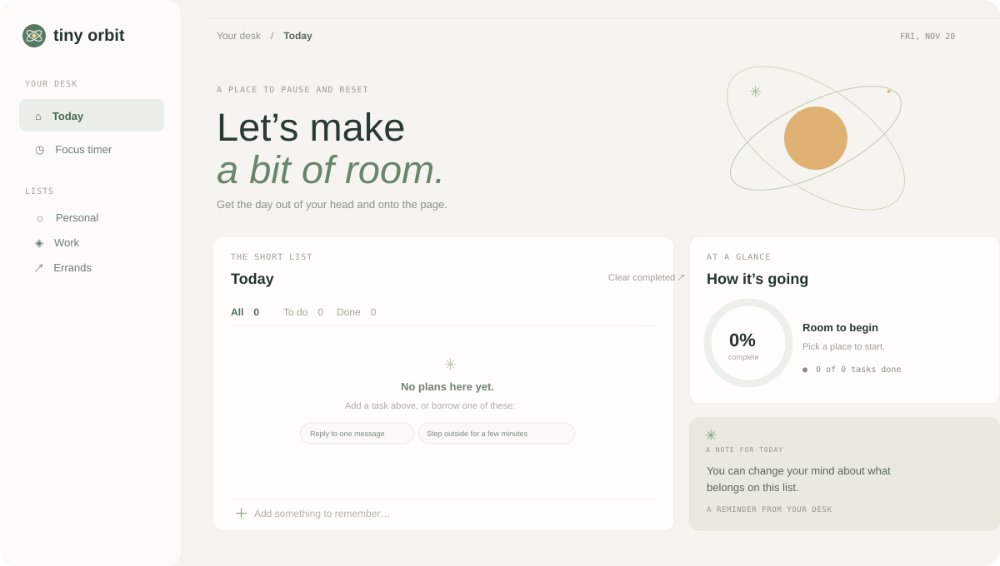

# Tiny Orbit

Tiny Orbit is a small, browser-only task list for keeping the day’s loose ends in one place. No account, setup, or notifications to manage.

It opens empty on purpose. Your to-dos are yours; a screen full of made-up examples never felt like a useful start.



## Open it

Open `index.html` in a current browser. If you prefer a local server, run this from the project folder:

```bash
python -m http.server 8000
```

Then go to `http://localhost:8000`.

## What it does

- Add, finish, filter, and remove tasks
- Keep tasks in Personal, Work, or Errands, or add a list of your own
- Use the 25-minute timer when a bit of structure helps
- See what you have checked off today and over the last week
- Works on narrow screens and respects reduced-motion settings

There is no server or account. Tasks and list names stay in this browser’s local storage; they do not sync to another device. **Reset my space** clears them. The focus timer is temporary and resets if you reload the page.

## Put it on GitHub Pages

Create a repository, add the files in this folder, then open **Settings → Pages**. Choose **Deploy from a branch**, select `main` and `/(root)`, and save. GitHub will show the site address on that page when it is ready.

## A few choices

The app uses plain HTML, CSS, and JavaScript so it can be opened without installing anything. Google Fonts add the type treatment; if they are unavailable, the page falls back to system fonts. There are no third-party scripts.

## Another small tool

[Pocket Pantry](./pocket-pantry/) is a browser-only list for keeping an eye on the ingredients you already have. It sorts items by date and saves them only in the current browser.

## License

MIT. See [`LICENSE`](./LICENSE).

